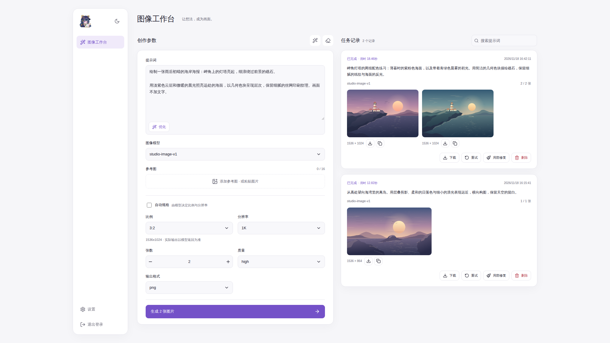

<h1 align="center">Bimage</h1>

<div align="center">

**A self-hosted AI image workbench.**

**English** · [简体中文](README_CN.MD)


</div>

## Overview

Connect your own OpenAI-compatible provider to generate images, edit them with references, and refine prompts. The workbench lets you queue jobs, search past prompts, and download the original images without leaving the page.



## Features

- **Generate and edit images.** Use text or up to 16 reference images. Let the model pick the image dimensions, or set them yourself. Export as PNG, JPEG, or WebP.
- **Refine prompts.** Draft a prompt from a short brief or review suggested edits character by character before applying them.
- **Keep track of jobs.** Bimage saves progress and sends a separate request for each image. Cancel images that are still queued without interrupting those already in progress.
- **Revisit past work.** Search by prompt, restore job settings, and download originals individually or as a ZIP archive.
- **Manage workspaces.** Sign in with an access key, share providers, and customize site branding. The interface adapts to smaller screens and supports light and dark themes.

## Tech stack

- **Frontend:** Vue 3, TypeScript, and Vite
- **Backend:** Node.js, Express, and TypeScript
- **Database:** SQLite (`node:sqlite`)

## Quick start

### Requirements

- Local development: Node.js 24+ and npm.
- Container deployment: Docker and Docker Compose v2. You do not need Node.js on the host.

### Local development

In one terminal, install dependencies, build the API, and start it:

```bash
git clone https://github.com/FangChanguwu/Bimage.git
cd Bimage
npm ci
npm --prefix backend ci
npm --prefix frontend ci
npm --prefix backend run build
HOST=127.0.0.1 npm --prefix backend start
```

In a second terminal, open the repository directory and start the frontend:

```bash
npm --prefix frontend run dev
```

Open [http://127.0.0.1:5178](http://127.0.0.1:5178). On first startup, Bimage writes the initial administrator access key to `data/admin-key.txt`.

Sign in, go to Settings (设置), and add an OpenAI-compatible provider. Select an image model for generation and a text model for prompt refinement. You can skip the text model if you only need image generation.

## Deployment

### Docker Compose

From the repository root, run:

```bash
cp .env.example .env
docker compose up -d --build --wait
```

The workbench is available at [http://localhost:6767](http://localhost:6767) by default. Compose does not publish a separate API port. On first startup, read the initial administrator access key from `data/admin-key.txt` in the mounted data directory.

### Environment variables

- `BIMAGE_PORT`: host port for the workbench. Defaults to `6767`.
- `BIMAGE_COOKIE_SECURE`: set to `true` when serving Bimage behind an HTTPS reverse proxy. Keep it `false` for local HTTP testing.

Use HTTPS for public deployments. Back up `data/` and keep it out of Git because it contains job history, images, and provider credentials. See the [backend configuration](backend/README.md) and the [API reference (Chinese)](docs/API.md) for details.

## Contributors

- **ChatGPT** (AI assistant): Kept saying “one more test.” It was never just one.

## License

Bimage is licensed under the [MIT License](LICENSE).
