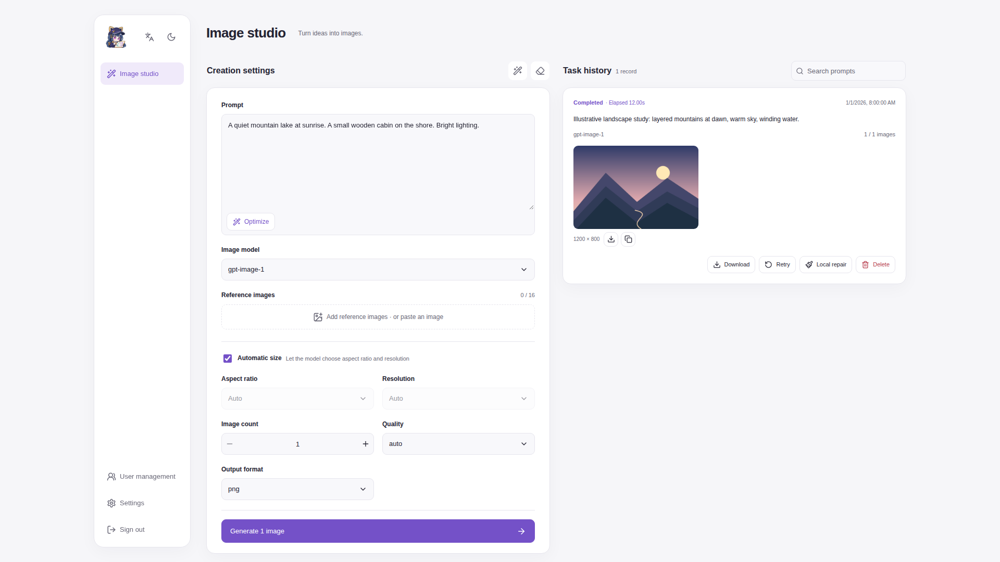

<p align="center">
  
</p>

<h1 align="center">Bimage</h1>

<div align="center">

**A self-hosted AI image workbench.**

**English** · [简体中文](README_CN.MD)


</div>

## Overview

Connect your own OpenAI-compatible provider to generate images, edit them with references, and refine prompts. The workbench lets you queue jobs, search past prompts, and download the original images without leaving the page.



## Features

- **Generate and edit images.** Use text or up to 16 reference images. Let the model pick the image dimensions, or set them yourself. Export as PNG, JPEG, or WebP.
- **Refine prompts.** Draft a prompt from a short brief or review suggested edits character by character before applying them.
- **Keep track of jobs.** Bimage saves progress and sends a separate request for each image. Cancel images that are still queued without interrupting those already in progress.
- **Revisit past work.** Search all prompts, load history in pages, restore job settings, and download originals individually or as a ZIP archive.
- **Load images efficiently.** Server-generated previews and account-scoped browser caching reduce repeated transfers. Clear local images in Settings; logout clears private cached data.
- **Manage workspaces.** Sign in with an account, share providers, and customize site branding. Administrators can create users and set their image-generation concurrency limits.
- **Switch languages.** Choose English or Simplified Chinese on the sign-in page or in the workbench sidebar. Bimage remembers your choice in the browser and keeps your current draft when you switch.

## Prompt optimization

Choose **Optimize** in the prompt editor to send the current prompt and any attached references to your configured text model. Bimage highlights additions and strikes through removals right in the editor. Edit the suggestion before choosing **Apply**, or choose **Cancel** to keep the original. Reviewing a suggestion does not queue an image job.


## Tech stack

- **Frontend:** Vue 3, TypeScript, and Vite
- **Backend:** Node.js, Express, and TypeScript
- **Database:** SQLite (`node:sqlite`)

## Quick start

### Requirements

- Local development: Node.js 24+ and npm.
- Container deployment: Docker and Docker Compose v2. You do not need Node.js on the host.

### Local development

In one terminal, install dependencies, build the API, and start it:

```bash
git clone https://github.com/FangChanguwu/Bimage.git
cd Bimage
npm ci
npm --prefix backend ci
npm --prefix frontend ci
npm --prefix backend run build
HOST=127.0.0.1 npm --prefix backend start
```

In a second terminal, open the repository directory and start the frontend:

```bash
npm --prefix frontend run dev
```

Open [http://127.0.0.1:5178](http://127.0.0.1:5178). For first-time setup, read the one-time code from `data/setup-code.txt` on the server and set your own password for `admin` in the web UI.

Sign in, open **Settings**, and add an OpenAI-compatible provider. In the Providers tab, choose independent defaults for image generation, quick prompts, and prompt optimization. You can skip text models if you only need image generation.

## Deployment

### First Docker Compose installation

Install Git, Docker Engine and a recent Docker Compose v2+ with `--wait` support. No host Node.js or container-registry account is required: Compose builds both images from this repository and downloads public base images and npm dependencies. The image names in `compose.yaml` are **local build tags**, not published registry images. Do not use `docker compose pull` as the update procedure.

```bash
git clone https://github.com/FangChanguwu/Bimage.git
cd Bimage
# Create only if absent; never overwrite an existing deployment's settings.
test -f .env || cp .env.example .env
# Edit .env before starting (see the settings below).
docker compose build
docker compose up -d --wait
```

Open [http://localhost:6767](http://localhost:6767). On the server, read the one-time setup code privately with `sudo cat data/setup-code.txt`, then enter it in the setup page and choose your own `admin` password. Do not send the code or password to chat, screenshots or logs. The mode-0600 code file is removed after successful setup. Existing accounts do not need setup again.

Check startup with `docker compose ps` and `curl --fail http://127.0.0.1:6767/health` (adjust the port if changed). For failures, inspect `docker compose logs --tail=100 api web` locally; redact secrets before sharing. Both services should be healthy. Only web port `6767` is published; API port `6768` stays internal. The default container names are fixed, so a second installation on the same Docker host also needs different container names, not just a different Compose project name or port.

### Network and persistent data

| `.env` setting | Default | Purpose |
| --- | --- | --- |
| `BIMAGE_PORT` | `6767` | Published web port. |
| `BIMAGE_BIND_HOST` | `0.0.0.0` | Use `127.0.0.1` when the HTTPS reverse proxy runs on the same host. |
| `BIMAGE_COOKIE_SECURE` | `false` | Use `true` for HTTPS; keep `false` only for local HTTP. |
| `BIMAGE_CONCURRENCY` | `8` | Site-wide image-task concurrency (1–8); accounts have separate limits. |

Do not send login credentials over public HTTP. For public access, configure a same-origin HTTPS reverse proxy that preserves the original `Host`, forwards `/api/` and `/health`, and restricts the upstream port to the proxy. For a containerized proxy, use a reachable private upstream instead of its own `127.0.0.1`. To preserve per-client rate limits, pin the exact trusted proxy socket addresses at both hops and overwrite `X-Real-IP` at the ingress; do not trust arbitrary forwarded headers. See [backend configuration](backend/README.md).

`./data` is bind-mounted into the API and contains SQLite, accounts, provider credentials, images, drafts and job history. Keep this entire directory and `.env` private and backed up. Rebuilding/recreating containers does not remove it. Never delete `data/`, run two API workers against it, or use `docker compose down -v` as an update/cleanup command. Keep any deployment-specific Compose override files and use the same options for every command below.

### Update an existing installation

Run from the **same checkout** with the same `.env`, data directory and Compose overrides. Arrange a maintenance window: stop new submissions, let all users' running/queued image tasks finish (or cancel queued tasks in the UI), and wait for prompt optimization/uploads to finish. The following block stops web access, then checks the entire queue without printing account or provider data. If the check fails, it leaves the API running: restore web with `docker compose up -d --wait web`, drain the queue, and retry. Never force an update of an active queue: interrupted paid requests may already have been charged.

```bash
(
  set -eu
  docker compose stop web
  docker compose exec -T api node --input-type=module -e '
    import { DatabaseSync } from "node:sqlite";
    const db = new DatabaseSync(process.env.DATA_DIR + "/studio.sqlite", { readOnly: true });
    const { n } = db.prepare("SELECT count(*) n FROM tasks WHERE status IN (?, ?)").get("queued", "running");
    db.close();
    if (n !== 0) throw new Error("Queue is not idle; drain it before updating");
    console.log("Queue idle");
  '
  docker compose stop api
  umask 077
  backup="$(pwd)/../Bimage-backup-$(date -u +%Y%m%dT%H%M%SZ)"
  mkdir -m 700 "$backup"
  cp -a data "$backup/data"
  cp -p .env "$backup/.env"
  git rev-parse HEAD > "$backup/source-commit.txt"
  docker compose images > "$backup/images.txt"
  printf 'Private backup: %s\n' "$backup"
  git pull --ff-only
  docker compose build
  docker compose up -d --force-recreate --wait
)
```

Keep local source changes out of the deployment checkout; resolve a failed `git pull` rather than resetting them away. The API stays stopped if backup, pull or build fails. Fix the error and resume only after confirming the backup is complete. `--force-recreate` replaces **both** services, including nginx so it resolves the new API address instead of retaining a stale upstream IP. `.env` is not replaced; compare new `.env.example` settings manually. Copy any private override/ingress files into the private backup as well.

After updating, check health as above, sign in with an existing account, and verify settings, history and an original image. A successful health check alone does not prove your data was preserved.

### Rollback

Keep the backup, previous source commit and previous local images until acceptance. During maintenance, stop web and API, preserve the failed `data/` under a different private name, then restore the **whole** backed-up `data/`, `.env` and any private overrides. Do not merge old/new database files or copy a live SQLite database by itself. Check out the recorded commit (`git switch --detach <saved-commit>`), rebuild with `docker compose build`, and start with `docker compose up -d --force-recreate --wait`; verify health and existing data again. If old source/dependencies are no longer buildable, use your saved matching API/web image tags with `BIMAGE_API_IMAGE` / `BIMAGE_WEB_IMAGE` and `docker compose up -d --no-build --pull never --force-recreate --wait`. Do not reuse data already migrated by a newer version with an older API: restore its matching backup. Rollback loses changes made after that backup; retain the failed copy for investigation.

See also the [API reference (Chinese)](docs/API.md).

## Build checks

After installing dependencies, run `npm run typecheck` and `npm run build` from the repository root to check and compile both services. Private development tests and their npm scripts are not included in the public deployment source.

## License

Bimage is licensed under the [MIT License](LICENSE).
