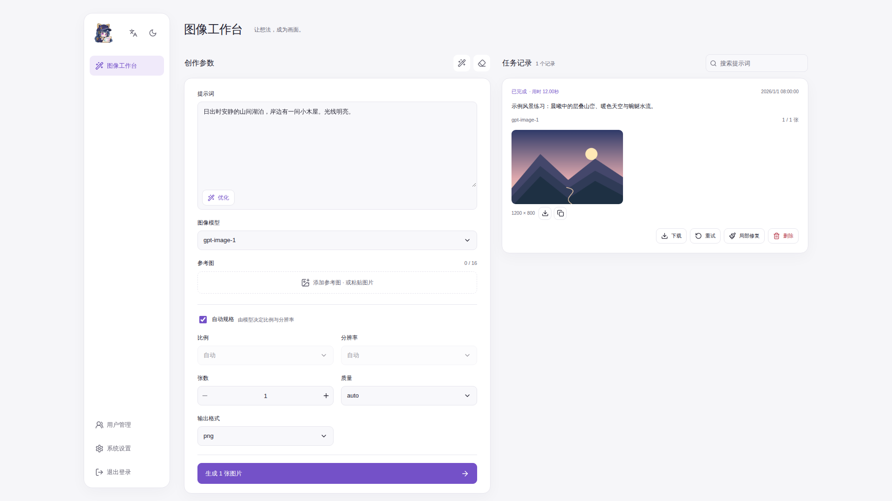

<p align="center">
  
</p>

<h1 align="center">Bimage</h1>

<div align="center">

**一个支持自托管的 AI 图像工作台。**

[English](README.MD) · **简体中文**


</div>

## 简介

Bimage 集图像生成、参考图编辑与提示词优化于一处。接入自己的 OpenAI 兼容服务后，可以在同一页面创建任务、查看队列、搜索历史和下载原图。



## 功能特性

- **图像创作** — 支持文生图、参考图编辑，最多可添加 16 张参考图；支持自动尺寸及 PNG、JPEG、WebP 输出。
- **提示词优化** — 从简短描述起草提示词，或在编辑框里查看逐字修改，仅在确认后应用。
- **持久化队列** — 逐张提交并保存进度；取消只影响仍在排队的图片，已经开始生成的图片继续完成。
- **历史与下载** — 支持全历史提示词搜索、分页加载、回填任务设置、单张原图下载和批量 ZIP 下载。
- **高效图片加载** — 服务端缩略图与账号隔离的浏览器持久缓存减少重复传输，可在设置中清理本地图片，退出登录自动清除私有缓存。
- **独立工作空间** — 使用账号密码登录，支持供应商共享和站点品牌设置；管理员可创建用户并设置生图并发上限。
- **中英文切换** — 可在登录页或工作台侧栏切换简体中文和 English，浏览器会记住上次选择，切换时保留当前草稿。

## 提示词优化

在提示词编辑框中点击「优化」，将当前提示词和已添加的参考图交给配置好的文本模型。优化结果会在原编辑框中高亮新增内容，用删除线标出删减内容。你可以编辑建议后点击「应用」，或点击「取消」保留原文。查看建议不会提交生图任务。


## 技术栈

- **前端：** Vue 3 + TypeScript + Vite
- **后端：** Node.js + Express + TypeScript
- **数据库：** SQLite（`node:sqlite`）

## 快速开始

### 环境要求

- 本地开发：Node.js 24+ 与 npm。
- 容器部署：Docker 和 Docker Compose v2，无需在宿主机安装 Node.js。

### 本地开发

在终端安装依赖、编译并启动 API：

```bash
git clone https://github.com/FangChanguwu/Bimage.git
cd Bimage
npm ci
npm --prefix backend ci
npm --prefix frontend ci
npm --prefix backend run build
HOST=127.0.0.1 npm --prefix backend start
```

在另一个终端进入仓库目录，启动前端：

```bash
npm --prefix frontend run dev
```

访问 [http://127.0.0.1:5178](http://127.0.0.1:5178)。首次设置时，从服务器的 `data/setup-code.txt` 读取一次性初始化码，在网页中为 `admin` 自定义密码。

登录后，在「系统设置」中添加 OpenAI 兼容供应商，在供应商页分别选择快速提示词、提示词优化和生图模型。只使用生图时，无需配置文本模型。

## 部署

### 首次 Docker Compose 安装

安装 Git、Docker Engine 和支持 `--wait` 的较新 Docker Compose v2+。宿主机无需 Node.js，也无需容器镜像仓库账号：Compose 从本仓库源码构建前后端，只需联网下载公开基础镜像和 npm 依赖。`compose.yaml` 中的镜像名是**本机构建标签**，不是已经发布的远程镜像，不要用 `docker compose pull` 代替更新。

```bash
git clone https://github.com/FangChanguwu/Bimage.git
cd Bimage
# 仅在不存在时创建，切勿覆盖已有部署配置。
test -f .env || cp .env.example .env
# 启动前按下表编辑 .env。
docker compose build
docker compose up -d --wait
```

访问 [http://localhost:6767](http://localhost:6767)。通过可信服务器终端私下执行 `sudo cat data/setup-code.txt`，将一次性初始化码填入设置页，并为 `admin` 自定义密码。不要将初始化码或密码发到聊天、截图或日志中。初始化成功后，权限为 0600 的码文件会被删除；已有账号无需重新初始化。

用 `docker compose ps` 和 `curl --fail http://127.0.0.1:6767/health` 检查启动（修改端口后同步调整地址）。异常时在本机查看 `docker compose logs --tail=100 api web`，分享前先脱敏。两个服务均应为 healthy。仅发布 web 的 `6767` 端口，API 的 `6768` 保持内部访问。默认容器名固定，同一 Docker 主机上安装第二套时，还需修改容器名，仅改 Compose 项目名或端口不够。

### 网络与持久化数据

| `.env` 配置 | 默认值 | 用途 |
| --- | --- | --- |
| `BIMAGE_PORT` | `6767` | 工作台对外端口。 |
| `BIMAGE_BIND_HOST` | `0.0.0.0` | HTTPS 反向代理位于同一宿主机时设为 `127.0.0.1`。 |
| `BIMAGE_COOKIE_SECURE` | `false` | HTTPS 访问设为 `true`；仅本机 HTTP 测试保留 `false`。 |
| `BIMAGE_CONCURRENCY` | `8` | 全站生图子任务并发（1–8），账号另有并发限制。 |

不要通过公网 HTTP 传输登录凭据。对外服务应使用同源 HTTPS 反向代理，保留原始 `Host`，转发 `/api/` 和 `/health`，并限制上游端口仅供代理访问。代理也在容器中时，使用其可达的私网上游，而不是代理自身的 `127.0.0.1`。需要按客户端独立限流时，应在两跳分别固定可信代理的精确 socket 地址，并由入口覆盖 `X-Real-IP`，不要信任任意客户端转发头；详见[后端配置](backend/README.md)。

`./data` 绑定挂载到 API，保存 SQLite、账号、供应商凭据、图片、草稿和任务历史。整个目录和 `.env` 都应私密保存并备份。重建镜像或容器不会删除这些数据。更新时切勿删除 `data/`、让两个 API worker 同时使用它，或执行 `docker compose down -v` 清理。保留部署专用 Compose 覆盖文件，下列每一步均需使用同一套选项。

### 更新已有部署

在**原检出目录**中操作，保留同一份 `.env`、数据目录和 Compose 覆盖配置。先安排维护窗口：停止新任务提交，等待所有用户的运行中／排队生图任务结束（或在界面取消排队任务），也等待提示词优化、上传完成。下列命令先关闭网页入口，再检查全站队列，不输出账号或供应商数据。若检查失败，API 保持运行；执行 `docker compose up -d --wait web` 恢复入口，清空队列后重试。切勿强行更新活跃队列：中断的付费请求可能已被上游计费。

```bash
(
  set -eu
  docker compose stop web
  docker compose exec -T api node --input-type=module -e '
    import { DatabaseSync } from "node:sqlite";
    const db = new DatabaseSync(process.env.DATA_DIR + "/studio.sqlite", { readOnly: true });
    const { n } = db.prepare("SELECT count(*) n FROM tasks WHERE status IN (?, ?)").get("queued", "running");
    db.close();
    if (n !== 0) throw new Error("Queue is not idle; drain it before updating");
    console.log("Queue idle");
  '
  docker compose stop api
  umask 077
  backup="$(pwd)/../Bimage-backup-$(date -u +%Y%m%dT%H%M%SZ)"
  mkdir -m 700 "$backup"
  cp -a data "$backup/data"
  cp -p .env "$backup/.env"
  git rev-parse HEAD > "$backup/source-commit.txt"
  docker compose images > "$backup/images.txt"
  printf 'Private backup: %s\n' "$backup"
  git pull --ff-only
  docker compose build
  docker compose up -d --force-recreate --wait
)
```

部署检出目录应保持无本地源码改动；`git pull` 失败时解决冲突，不要强制重置丢弃修改。备份、拉取或构建失败后 API 仍停止，应先解决问题并确认备份完整再恢复。`--force-recreate` 会替换**两个**服务，确保 nginx 重新解析 API 地址，不沿用旧容器 IP。更新不会覆盖 `.env`，请手动比较新版 `.env.example`；私有覆盖文件和入口代理配置也应另行复制到备份目录。

更新后按前述方法检查健康状态，再用已有账号登录，核对设置、历史和一张原图。仅健康检查通过并不能证明数据保留成功。

### 回滚

验收前保留备份、旧源码提交和旧本地镜像。维护期间停止 web 与 API，将故障现场的 `data/` 改名私下保留，再恢复备份中的**整个** `data/`、`.env` 及私有覆盖配置；不要混合新旧数据库文件，也不要单独复制运行中的 SQLite 主文件。检出记录的旧提交（`git switch --detach <saved-commit>`），执行 `docker compose build` 和 `docker compose up -d --force-recreate --wait`，重新核对健康与原有数据。如果旧源码／依赖已无法构建，可通过 `BIMAGE_API_IMAGE` / `BIMAGE_WEB_IMAGE` 指定保留的配套旧镜像标签，再执行 `docker compose up -d --no-build --pull never --force-recreate --wait`。不要让旧 API 使用已被新版迁移的数据，应同时恢复对应备份。回滚会丢失备份之后的变更，保留故障现场副本以便调查。

接口说明见 [API 文档](docs/API.md)。

## 构建检查

安装依赖后，在仓库根目录执行 `npm run typecheck` 和 `npm run build`，可检查并编译前后端。公开部署源码不包含私有开发测试及其 npm 脚本。

## 许可证

本项目基于 [MIT License](LICENSE) 开源。
