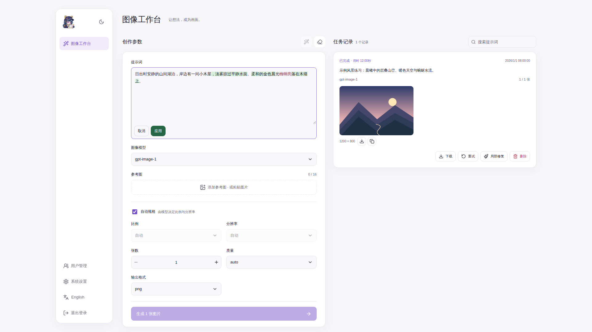

<p align="center">
  
</p>

<h1 align="center">Bimage</h1>

<div align="center">

**一个支持自托管的 AI 图像工作台。**

[English](README.MD) · **简体中文**


</div>

接入自己的 OpenAI 兼容服务，在同一页面完成图像生成、参考图编辑、提示词优化与历史任务管理。


## 功能特性

- **图像创作** — 支持文生图与参考图编辑（最多 16 张），支持自动/自定义尺寸与 PNG / JPEG / WebP 导出。
- **提示词优化** — 由简短描述生成提示词，或在编辑框内逐字对比修改并按需应用。
- **持久化队列** — 逐张请求并持久化进度；取消仅影响排队任务，不中断生成中的图片。
- **历史与导出** — 全量提示词搜索、分页加载、一键回填参数、原图单张及 ZIP 批量下载。
- **缓存加速** — 服务端缩略图与账号隔离的浏览器持久缓存（可在设置中清理，退出登录自动清除）。
- **多用户与管理** — 账号登录、供应商共享、站点品牌自定义、账号并发上限，以及仅管理员可用的 GitHub 版本检测与回退。
- **中英文切换** — 随时切换简体中文 / English，切换时保留当前草稿。



## Docker Compose 部署

需要 Docker 与 Docker Compose v2+（支持 `--wait`），镜像由本仓库源码本地构建。

```bash
git clone https://github.com/FangChanguwu/Bimage.git
cd Bimage
test -f .env || cp .env.example .env
# 按需修改 .env
docker compose build
docker compose up -d --wait
```

- **首次初始化**：私下执行 `docker compose logs api` 获取一次性初始化链接，打开后创建首个管理员账号。
- **数据持久化**：`./data` 保存 SQLite、图片与配置，更新前请备份，切勿执行 `docker compose down -v`。
- **公网 HTTPS**：对外开放请使用同源 HTTPS 反向代理，将 `BIMAGE_PUBLIC_URL` 设为实际访问地址、`BIMAGE_COOKIE_SECURE=true`、`BIMAGE_BIND_HOST=127.0.0.1`；代理头配置见 [backend/README.md](backend/README.md)。

| 变量 | 默认值 | 说明 |
| --- | --- | --- |
| `BIMAGE_PORT` | `6767` | 对外 Web 端口（API 仅内部监听 `6768`）。 |
| `BIMAGE_PUBLIC_URL` | `http://localhost:6767` | 用于生成初始化链接的可信 HTTP(S) 源地址（不含路径）。 |
| `BIMAGE_BIND_HOST` | `0.0.0.0` | 与反向代理同机部署时建议设为 `127.0.0.1`。 |
| `BIMAGE_COOKIE_SECURE` | `false` | 使用 HTTPS 访问时设为 `true`。 |
| `BIMAGE_CONCURRENCY` | `8` | 全站生图并发上限（1–8）。 |

### 更新与回滚

等待运行中／排队中的任务完成并备份 `./data` 和 `.env`，随后执行：

```bash
git pull --ff-only
docker compose build
docker compose up -d --force-recreate --wait
```

如需回滚，先停止容器，恢复对应的 `./data` 备份，切换到目标版本（`git checkout <tag>`），再按上述命令重建启动即可。

## 本地开发

需要 Node.js 24+ 与 npm。

```bash
# 终端 1：启动后端 API
git clone https://github.com/FangChanguwu/Bimage.git
cd Bimage
npm ci && npm --prefix backend ci && npm --prefix frontend ci
npm --prefix backend run build
BIMAGE_PUBLIC_URL=http://127.0.0.1:5178 HOST=127.0.0.1 npm --prefix backend start
```

```bash
# 终端 2：启动前端
npm --prefix frontend run dev
```

打开 API 终端打印的初始化链接创建首个管理员，之后访问 [http://127.0.0.1:5178](http://127.0.0.1:5178) 登录，并在「系统设置」中添加 OpenAI 兼容供应商。在根目录执行 `npm run build` 可一次编译前后端。

## 技术栈与文档

- **技术栈**：Vue 3 · TypeScript · Vite · Node.js · Express · SQLite (`node:sqlite`)
- **相关文档**：[API 文档](docs/API.md) · [后端配置](backend/README.md) · [更新日志](CHANGELOG.md)

## 许可证

[MIT](LICENSE)
